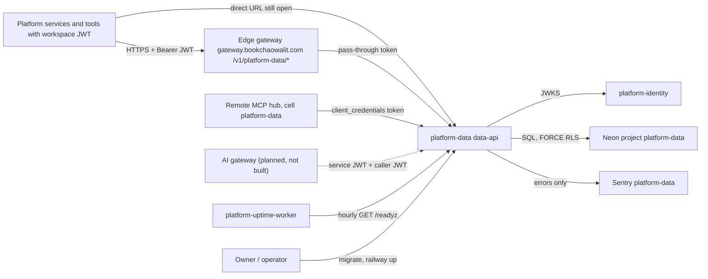
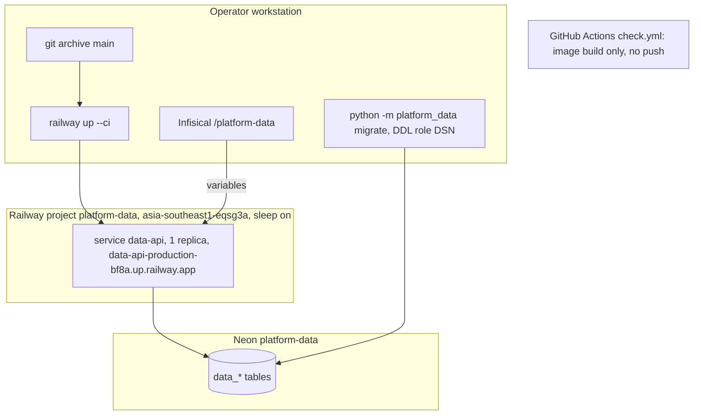

# Book Data Platform — System Architecture

เอกสารนี้สรุปสถาปัตยกรรมของ `platform-data` (service `data-api`) จากโค้ดและ config ใน repo ณ `origin/main` `5b25436` (2026-11-04)
ข้อมูล hosting ที่ไม่อยู่ใน repo อ้างจาก ops record: book-platforms-status (2026-11-03), Railway API ที่บันทึกไว้ใน
[16-deployment.md](../docs/diagrams/16-deployment.md) และ routes ของ platform-api-gateway
รายละเอียดเชิงลึกอยู่ใน Core 22 diagram pack [`docs/diagrams/`](../docs/diagrams/README.md) — เอกสารนี้ลิงก์ไป ไม่คัดลอก

> หมายเหตุ: subtitle ใน `docpack.yaml` ("ยังไม่มี runtime") และ `00-product-card.md` ล้าสมัย — runtime มีตั้งแต่ 2026-10-15 (`8ecf228`)
> และ live บน Railway ตั้งแต่ 2026-10-29; tier ยังเป็น `L0` ตามเดิม

## 1. Architecture style และเหตุผล

| ด้าน | รูปแบบที่ใช้ | เหตุผล / หลักฐาน |
|---|---|---|
| ขอบเขตระบบ | microservice หนึ่งตัวของ Book Platform ที่เป็นเจ้าของ primitive ข้อมูลระดับ workspace (cache, counters, documents, quota) | `contract.json`, `README.md`, `docs/runtime.md` |
| โครงภายใน | FastAPI app ไฟล์เดียว + module `service_admissions` + CLI `serve`/`migrate` | `src/platform_data/` (648 บรรทัด) |
| shared runtime | `platform-backend-core` pin commit `21d5f44` ผ่าน `uv.lock` | `pyproject.toml` `[tool.uv.sources]`, [ADR-0002](../docs/diagrams/08-adr/ADR-0002-shared-core-pinned-git-commit.md) |
| multi-tenancy | shared tables + FORCE RLS ทุกตาราง keyed บน JWT `ws` | `migrations.py` (`_RLS`), [ADR-0001](../docs/diagrams/08-adr/ADR-0001-postgres-force-rls-workspace-isolation.md) |
| ความถูกต้องของ quota | durable admission: reserve → settle/release, ตัดจริงตอน reserve, overrun กลายเป็น debt ที่ freeze policy | `app.py`, `service_admissions.py`, [ADR-0003](../docs/diagrams/08-adr/ADR-0003-durable-quota-admission-debt-freeze.md) |
| Postgres-only | ไม่มี Redis หรือ search engine แยก: cache, counter และ full-text search (`tsvector` + GIN) อยู่ใน PostgreSQL | `migrations.py` (`data_documents.search`, `data_cache_expiry`) |
| hosting | serverless บน Railway Singapore + Neon ของตัวเอง, deploy ด้วย CLI | [ADR-0004](../docs/diagrams/08-adr/ADR-0004-railway-serverless-cli-deploy.md) |

## 2. Quality-attribute scenarios

| QA | Scenario (stimulus → response) | กลไกในโค้ด | หลักฐาน |
|---|---|---|---|
| Security / isolation | token workspace A อ่าน cache/document ของ workspace B → ไม่พบ | FORCE RLS policy `workspace_isolation` + core ตั้ง workspace ต่อ transaction | `migrations.py`, core `db.py`, `tests/runtime/test_api.py` |
| Security / authz | caller ไม่มี scope ที่ route ต้องการ (`cache:*`, `counters:write`, `documents:*`, `quotas:*`) → 403 | `require_scope(...)` ทุก route | `app.py` |
| Security / service admission | service ที่ไม่ใช่ system workspace หรือ caller ไม่มี `ai:generate` → 403; ไม่ตั้ง system workspace → 503 | `pair()` เช็ค `quotas:service`, `PLATFORM_SYSTEM_WORKSPACE_ID`, header `x-workspace-authorization` | `service_admissions.py` |
| Correctness (quota) | reservation หมดอายุโดยไม่ settle → units ยังนับว่าใช้แล้ว; settle เกิน limit → policy ติด debt และ reserve ถัดไปได้ 429 | `capacity=0 if debt`, `debt=max(0,used-limit)` | `app.py` (บรรทัด ~226, ~249), ADR-0003 |
| Input bounds | key ยาวเกิน 200, document เกิน 200,000 ตัวอักษร, query เกิน 512 / limit เกิน 100 → 422 | pydantic `Field` / `Query` constraints | `app.py` |
| Availability (cold start) | request แรกหลัง Neon หลับ → ตอบได้ภายใน pool wait 20 s / connect 15 s | core `21d5f44` | ops record, core `db.py` |
| Concurrency | request พร้อมกันเกิน 64 → ปฏิเสธส่วนเกิน | `limit_concurrency=64`, `timeout_keep_alive=5`, `timeout_graceful_shutdown=30` | `__main__.py` |
| Readiness | migration history หรือ privilege ไม่ตรง → `/readyz` ไม่ 200 | `schema_ready` เช็ค history + privilege ใน query เดียว (`f533a03`) | `app.py` |
| Privacy (telemetry) | exception มีข้อความผู้ใช้ → Sentry ไม่ได้รับ | `_scrub_event` + `CaptureErrors` | `_sentry.py`, [ADR-0005](../docs/diagrams/08-adr/ADR-0005-sentry-no-free-text.md) |
| Safety at startup | `serve` ไม่ auto-migrate; config ผิด → exit 1 พร้อมข้อความกลางที่ไม่มี secret | `main()` | `__main__.py` docstring |

## 3. Context diagram

ภาพ C4 แบบเต็ม: [05-c4-context.md](../docs/diagrams/05-c4-context.md), [06-c4-container.md](../docs/diagrams/06-c4-container.md), [07-c4-component.md](../docs/diagrams/07-c4-component.md)

## 4. Components / containers

| Container / module | เทคโนโลยี | หน้าที่ | หลักฐาน |
|---|---|---|---|
| data-api (`serve`) | Python 3.12, FastAPI, uvicorn, core `21d5f44` | cache `PUT/GET/DELETE /v1/cache/{key}`, `POST /v1/counters/{key}/increment`, documents `PUT/DELETE /v1/documents/{key}` + `GET /v1/documents?q=`, `PUT /v1/quotas/{key}`, reservations `POST /v1/reservations`, `/{id}/settle`, `/{id}/release`; `/healthz`, `/readyz`, `/metrics` จาก core | `app.py` |
| `service_admissions` | module ใน app เดียวกัน | `POST /v1/service/admissions` (+ settle/release): composite admission สอง leg (caller workspace + global policy ของ system workspace) | `service_admissions.py` |
| `migrate` | CLI | `MigrationRunner(namespace='data')` apply `001_data_primitives`, `002_service_admissions` ด้วย `DATABASE_URL` ของ DDL role | `__main__.py`, `migrations.py` |
| `_sentry` | sentry-sdk | opt-in เมื่อมี `SENTRY_DSN` | `_sentry.py` |

Component view (C4 level 3): [07-c4-component.md](../docs/diagrams/07-c4-component.md)

## 5. Tech stack

| ชั้น | เทคโนโลยี | หลักฐาน |
|---|---|---|
| Runtime | Python 3.12 (`requires-python >=3.12`) | `pyproject.toml` |
| Web | FastAPI ผ่าน core, uvicorn `>=0.30,<1` | `pyproject.toml` |
| Shared core | `platform-backend-core==0.1.0` จาก git rev `21d5f44d26220080cbed43b9807979dc84a8533a` | `pyproject.toml`, `uv.lock` |
| Observability | sentry-sdk `>=2.72,<3`, `/metrics` ของ core | `pyproject.toml` |
| Build | 2-stage `python:3.12-slim`, `uv sync --frozen --no-dev` (uv 0.13.1 pin digest), user `65532:65532` | `Dockerfile` |
| Quality tools | Ruff 0.17.1, mypy 2.4.0, pytest-cov | `pyproject.toml`, `check.yml` |

## 6. Data stores

| Store | ข้อมูล | หมายเหตุ | หลักฐาน |
|---|---|---|---|
| PostgreSQL (Neon project `platform-data`) | `data_cache`, `data_counters`, `data_documents` (`tsvector` GENERATED + GIN), `data_quota_policies`, `data_quota_buckets`, `data_reservations`, `data_service_admissions` + `platform_schema_migrations` | FORCE RLS ทุกตาราง; ไม่มี retention job (cache/bucket/reservation ที่หมดอายุสะสม) | `migrations.py`, [09-erd.md](../docs/diagrams/09-erd.md), `docs/runtime.md` |
| Vendored contract | `contracts/vendor/data-product-contracts-v2.yaml` + `.sha256` | ใช้ตรวจ lineage BOO-152 ใน CI เท่านั้น ไม่ใช่ runtime store | `contracts/vendor/`, `docs/gates/BOO-152-data-product-lineage.md` |

## 7. Integrations

| ระบบ | ทิศทาง | ใช้ทำอะไร | สถานะ / หลักฐาน |
|---|---|---|---|
| platform-identity (issuer + JWKS) | data → identity | verify RS256 JWT (`JWT_ISSUER`, `JWT_AUDIENCE`, `JWT_JWKS_URL` หรือ `JWT_PUBLIC_KEY`) | live; audience ตาม ops record คือ `data-api` แต่ `docs/runtime.md` เขียน `platform-api` (ดู Open questions) |
| Edge gateway | caller → gateway → data | ingress `/v1/platform-data/<path>`, token pass-through | route `platform-data` ใน platform-api-gateway `routes.json` @ `4a31ff5`; data ไม่เช็ค `X-Gateway-Assertion` |
| Remote MCP hub | hub → data | cell `platform-data` | ops record (2026-11-03) |
| AI gateway | ai-gateway → data (`/v1/service/admissions`) | admission ของ AI usage | ยังไม่มี caller จริง (platform-ai เป็น scaffold, owner decision เปิดอยู่) — ops record |
| Neon PostgreSQL | data → DB | `DATABASE_URL` | live |
| Sentry | data → Sentry | errors ไม่มี free text (`SENTRY_DSN`, `SENTRY_ENVIRONMENT`, `SENTRY_RELEASE`) | project `platform-data` (ops record) |
| platform-uptime-worker | uptime → data | `GET /readyz` ทุกชั่วโมง | ops record |
| data lake (solo-empire) | contract เท่านั้น | lake interfaces ยังอยู่ใน solo-empire; repo นี้ตรวจ lineage ที่ pinned commit ของ 6 repo ข้อมูล | `docs/CONTRACT-SURFACE.md`, job BOO-152 ใน `check.yml` |
| R2 / Queues / Kafka | — | ไม่มีการใช้ใน `src/` | — |

## 8. Deployment topology

- push เข้า `main` ไม่ deploy เอง; ไม่มี branch protection (ดู [18-git-release-workflow.md](../docs/diagrams/18-git-release-workflow.md))
- Railway service ตั้ง builder `RAILPACK` ตาม Railway API 2026-11-03 แม้ repo มี `Dockerfile` — ดู [16-deployment.md](../docs/diagrams/16-deployment.md)

## 9. ADR สำคัญ

| ID | การตัดสินใจ | ไฟล์ |
|---|---|---|
| ADR-0001 | PostgreSQL FORCE RLS keyed บน `ws` ที่ verify แล้ว | [ADR-0001](../docs/diagrams/08-adr/ADR-0001-postgres-force-rls-workspace-isolation.md) |
| ADR-0002 | สร้างบน `platform-backend-core` pin git commit | [ADR-0002](../docs/diagrams/08-adr/ADR-0002-shared-core-pinned-git-commit.md) |
| ADR-0003 | Durable quota admission: charge at reserve, debt freeze | [ADR-0003](../docs/diagrams/08-adr/ADR-0003-durable-quota-admission-debt-freeze.md) |
| ADR-0004 | Railway serverless Singapore + Neon ต่อ service, CLI deploy | [ADR-0004](../docs/diagrams/08-adr/ADR-0004-railway-serverless-cli-deploy.md) |
| ADR-0005 | Sentry errors only, no free text | [ADR-0005](../docs/diagrams/08-adr/ADR-0005-sentry-no-free-text.md) |

## 10. Fitness functions

| สิ่งที่ guard | Check | ที่รัน |
|---|---|---|
| lock resolve core commit ที่ review แล้ว; dependency มาจาก lock เท่านั้น; image multi-stage non-root; `.dockerignore` | `tests/test_build_hygiene.py` | `check.yml` |
| workflow action pin SHA เต็ม | `test_every_workflow_action_is_sha_pinned` | `check.yml` |
| vendored schema ตรง canonical pin; contract ตรง registry | `scripts/check_schema_pin.py`, `scripts/check_registry_alignment.py`, `tests/test_drift_checks.py`, `scripts/check.py` | `check.yml` |
| workspace isolation, quota semantics, admission actor binding | `tests/runtime/test_api.py`, `tests/runtime/test_service_admissions.py` บน Postgres จริง (`postgres: true`) | reusable `ci-python.yml` @ `87dc5e1c` |
| ไม่มี free text ออกไป Sentry | `tests/test_sentry.py`, `tests/runtime/test_sentry_boundary.py` | `check.yml` |
| coverage ≥ 86% | `coverage-threshold: "86"` | `check.yml` → `ci-python.yml` |
| lineage evidence BOO-152 ที่ pinned commit ของ 6 repo | `scripts/check_data_product_lineage.py`, `tests/test_data_product_lineage.py` | job lineage ใน `check.yml` |
| image import ได้ และรัน non-root | job container image (build only) | `check.yml` |
| dependency / secret scan | reusable `security.yml` @ `87dc5e1c` | `check.yml` |

## 11. เอกสารลงรายละเอียด phase 07

| Template | สถานะ | ลิงก์ / เหตุผล |
|---|---|---|
| `sdlc/infrastructure-and-network-design.md` | partial (ใช้ diagram แทน) | [16-deployment.md](../docs/diagrams/16-deployment.md), [19-service-dependency-map.md](../docs/diagrams/19-service-dependency-map.md) |
| `sdlc/observability-design.md` | partial | [20-observability.md](../docs/diagrams/20-observability.md); ไม่มี SLO |
| `sdlc/capacity-performance-and-cost-plan.md` | not_applicable | tier L0; ไม่มี load test / cost model ใน repo |
| `sdlc/failure-mode-analysis.md` | partial | [13-threat-model.md](../docs/diagrams/13-threat-model.md), [14-backup-dr.md](../docs/diagrams/14-backup-dr.md), [21-incident-response.md](../docs/diagrams/21-incident-response.md), rollback ใน [`docs/runtime.md`](../docs/runtime.md) |
| `sdlc/async-integration-contract.md` | not_applicable | ไม่มี event, queue, webhook หรือ scheduled job; reservation หมดอายุตรวจแบบ lazy ตอนอ่าน (`expires_at<=clock_timestamp()`) |
| `sdlc/frontend-architecture.md` | not_applicable | ไม่มี UI |
| `sdlc/tech-debt-register.md` | partial | [`docs/UPGRADE-PLAN.md`](../docs/UPGRADE-PLAN.md) |
| `operations/system-landscape.md` | done (row มีแล้ว) | architecture-docs `operations/platform/SYSTEM-LANDSCAPE-GENERATED.md` @ `2107a91`: `platform-data` online, railway/serverless |
| `development-cycle/vendor-dependency-review.md` | not_applicable (ยังไม่ทำ) | Railway, Neon, Sentry free tier; ยังไม่มี exit plan |

## 12. Open questions

- audience จริงของ token: `data-api` (ops record) หรือ `platform-api` (`docs/runtime.md`)
- Railway build ใช้ `Dockerfile` หรือ Railpack auto-detect (ผลต่อ non-root และ dev extras)
- ใครจะเป็น caller จริงของ `/v1/service/admissions` (AI gateway ยังเป็น owner decision)
- retention ของ cache / bucket / reservation ที่หมดอายุ — ยังไม่มี job
- จะปิด direct Railway URL หลัง gateway cutover หรือไม่ และ `/metrics` ควรเปิดสาธารณะหรือไม่ (ดู [13-threat-model.md](../docs/diagrams/13-threat-model.md))
- ควรอัปเดต product card / `PRODUCT.md` / `README.md` ที่ยังเขียนว่า "not deployed"

## การอนุมัติ

| บทบาท | สถานะ | วันที่ | ลงนาม |
|---|---|---|---|
| Solution Architect (Book Dev) | รอตรวจ | — | [ต้องยืนยัน] |
| Owner | รอตรวจ | — | [ต้องยืนยัน] |

## แหล่งข้อมูล

- repo `platform-data` ที่ `origin/main` `5b25436` (2026-11-04)
- `pyproject.toml`, `Dockerfile`, `uv.lock`, `contract.json`, `DOCPACK/docpack.yaml`, `DOCPACK/00-product-card.md`
- `src/platform_data/__main__.py`, `app.py`, `service_admissions.py`, `migrations.py`, `_sentry.py`
- `.github/workflows/check.yml`, `scripts/*.py`, `scripts/check.sh`, `tests/**`, `contracts/vendor/`
- `docs/runtime.md`, `docs/CONTRACT-SURFACE.md`, `docs/UPGRADE-PLAN.md`, `docs/gates/BOO-152-data-product-lineage.md`, `docs/diagrams/*` (pack ที่ `0e724ac`, แก้ `5b25436`)
- platform-api-gateway `routes.json` และ `README.md` @ `4a31ff5`
- architecture-docs `operations/platform/SYSTEM-LANDSCAPE-GENERATED.md` @ `2107a91`
- ops record: book-platforms-status (2026-11-03), api-gateway-edge (2026-11-03)
