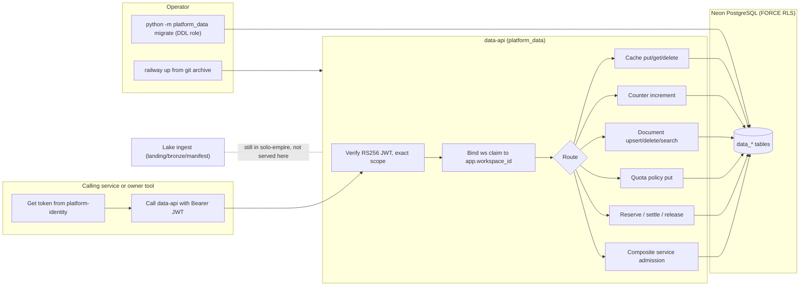
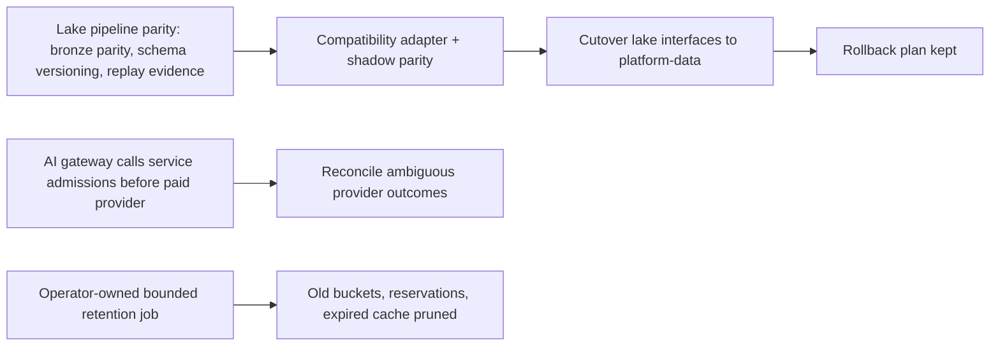

# 01 — Business process (As-Is / To-Be)

Status: **done**

platform-data เป็น backend platform service ไม่มี UI "ธุรกิจ" ของมันคือให้บริการ data primitive ร่วม (cache, counter,
document search, quota admission) ให้ service อื่นใช้แทนการเก็บสำเนาของตัวเอง และถือ lake contract เดิมไว้
([PRODUCT.md](../../PRODUCT.md))

## As-Is (จากโค้ดวันนี้)

Sources: `src/platform_data/app.py`, `src/platform_data/service_admissions.py`, `src/platform_data/__main__.py`,
`docs/CONTRACT-SURFACE.md`, `README.md`; ops record: book-platforms-status (2026-11-03) for identity issuer and deploy recipe.

ข้อสังเกต As-Is:
- lake interfaces (`data.cli.ingest`, `data.object-store.*`) มีสถานะ `current-in-solo-empire` — repo นี้ไม่ได้ serve
- migrate ทำแยกด้วย DDL role, startup ไม่ migrate (`__main__.py`)

## To-Be (จาก PRODUCT.md / UPGRADE-PLAN.md / runtime.md เท่านั้น)

Sources: `contract.json` (`migration`, `migration_gates`), `PRODUCT.md` (Limits), `docs/UPGRADE-PLAN.md` (Backlog P0–P2),
`docs/runtime.md` ("Admission and accounting contract", "Composite service admission extension").

## Open questions

- ใครเป็น consumer ตัวจริงของ cache/counter/document ใน production ตอนนี้? (ops record ระบุแค่ MCP hub cell `platform-data`)
- To-Be ของ lake cutover มีกำหนดเวลาหรือ owner decision หรือยัง? UPGRADE-PLAN ไม่ระบุวัน
- `docs/UPGRADE-PLAN.md` P2 "Add a health endpoint" — มีแล้วจาก core (`/healthz`, `/readyz`) ควรปิดรายการนี้หรือไม่
