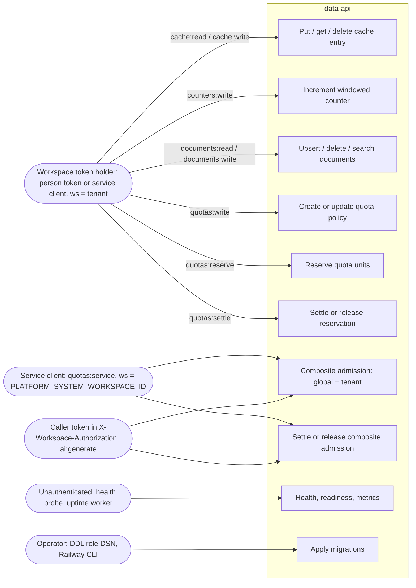

# 02 — Use cases

Status: **done**

Actor คือ "สิทธิ์" ที่ service ตรวจจริง: JWT RS256 ที่มี `sub`, `ws`, `scope` (core `TokenVerifier`) และ scope ต่อ route
(`require_scope`). Workspace มาจาก claim `ws` ที่ลงลายมือชื่อเท่านั้น

Sources: `src/platform_data/app.py` (`require_scope(...)` per route), `src/platform_data/service_admissions.py` (`pair`),
`src/platform_data/__main__.py`, platform-backend-core @`21d5f44` `http.py` (`require_scope`, `/healthz`, `/readyz`, `/metrics`)
and `auth.py` (required claims `sub, ws, iat, exp, jti, iss, aud`).

| Actor | ตรวจอะไรในโค้ด | ผลเมื่อไม่ผ่าน |
|---|---|---|
| Workspace token holder | `Authorization: Bearer`, RS256, issuer/audience ตาม env, scope ตรงตัว | 401 / 403 |
| Service client | scope `quotas:service` และ `ws == system_workspace` | 503 ถ้าไม่ตั้ง system workspace, 403 ถ้า ws ผิด |
| Caller (X-Workspace-Authorization) | verify แยกด้วย verifier เดียวกัน, ต้องมี `ai:generate` | 401 / 403; actor ต่างคน 403, tenant ต่าง 404 |
| Operator | `DATABASE_URL` ของ DDL role ตอน `migrate` | exit 1 ข้อความกลาง |
| Unauthenticated | ไม่มี auth บน `/healthz` `/readyz` `/metrics` | — |

ops record: book-platforms-status (2026-11-03): issuer = platform-identity, audience = `<svc>-api`; owner grants ให้ทั้ง 8 service;
MCP hub (service client `mcp-hub`) เป็น caller ที่ยืนยันแล้ว และ "no jobs:work/quotas:reserve/settle/audit:write"

## Open questions

- Person token ยังไม่มี (`IDENTITY_GOOGLE_CLIENT_IDS` ค้างที่ owner) — ใครถือ workspace token ของ data จริงนอกจาก MCP hub?
- service client ไหนได้ `quotas:service` และ caller ไหนได้ `ai:generate` ใน identity? ops record บอกว่า AI gateway caller ยังไม่มี
