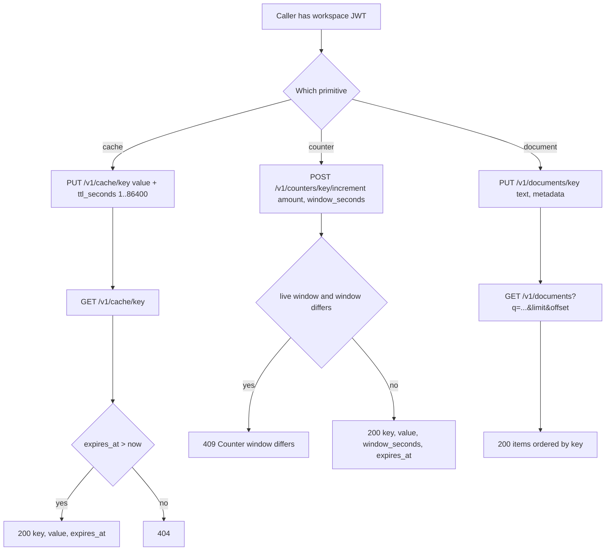
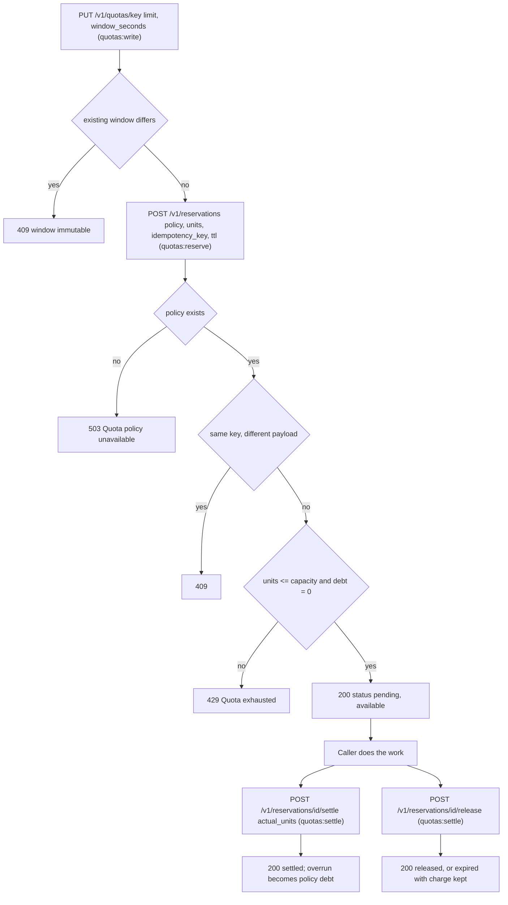
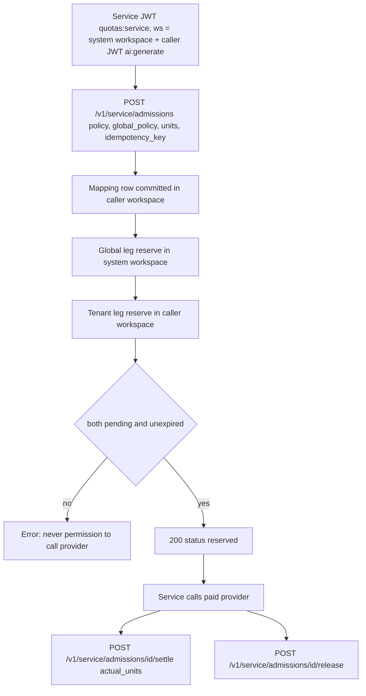

# 03 — User (caller) flows

Status: **done** — service ไม่มีหน้าเว็บ จึงเป็น API call flow ต่อ caller ส่วน semantics ละเอียดดู [runtime.md](../runtime.md) (reused)

## Flow A — Workspace caller: cache / counter / document

## Flow B — Workspace caller: quota policy → reserve → settle / release

## Flow C — Trusted service: composite admission for an AI call

Sources: `src/platform_data/app.py`, `src/platform_data/service_admissions.py`, `docs/runtime.md` ("Public API",
"Admission and accounting contract", "Composite service admission extension").

## Open questions

- ไม่มี caller ตัวจริงของ Flow C (ops record: AI gateway caller ยังไม่มี) — flow นี้ทดสอบแค่ใน `tests/runtime/test_service_admissions.py`
- MCP hub ใช้ flow ไหนบ้างจริง? hub ไม่มี `quotas:reserve/settle` จึงทำ Flow B ได้ไม่ครบ
