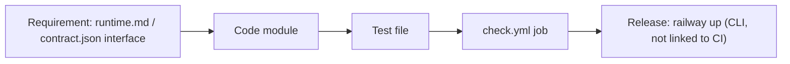

# 04 — Traceability (RTM)

Status: **done** — repo ไม่มี `specs/`; requirement มาจาก `docs/runtime.md`, `docs/CONTRACT-SURFACE.md` (interface IDs จาก `contract.json`)
และ gate `BOO-152`

| Requirement (source) | Code module | Test file(s) | CI job | Release |
|---|---|---|---|---|
| `data.http.cache` — 64 KiB, TTL, GET never extends (runtime.md) | `app.py` `cache_put/get/delete`, `bounded_json` | `tests/runtime/test_api.py::test_cache_isolation_expiry_and_bounds`, `test_cache_accepts_literal_escaped_unicode_text`, `test_rejects_postgres_unsupported_text_and_large_json` | `python` (ci-python) | Railway CLI |
| `data.http.counters` — atomic, fixed window, 409 on window change | `app.py` `increment` | `test_api.py::test_counters_atomic_stable_window_and_tenant`, `test_counter_window_expires_once` | `python` | Railway CLI |
| `data.http.documents` — `simple` tsvector, plainto_tsquery, paging | `app.py` `document_put/delete/search`, migration 001 | `test_api.py::test_search_plain_text_isolation_and_page` | `python` | Railway CLI |
| `data.http.quotas` — window immutable, limit update keeps debt | `app.py` `quota_put` | `test_api.py::test_missing_policy_auth_and_caller_authority`, `test_overrun_debt_blocks_following_windows` | `python` | Railway CLI |
| `data.http.reservations/settle/release` — never overshoot, exactly once, expiry stays charged | `app.py` `reserve`, `finish`, `expire` | `test_api.py::test_concurrent_reservations_never_overshoot`, `test_idempotency_conflict_and_settle_release_exactly_once`, `test_expiry_stays_charged_and_late_settlement`, `test_concurrent_duplicate_finalize_only_changes_usage_once`, `test_independent_processes_share_capacity`, `test_restart_and_cross_tenant_reservation` | `python` | Railway CLI |
| `data.http.service-*` — dual JWT, actor binding, conservative recovery | `service_admissions.py` | `tests/runtime/test_service_admissions.py` (19 tests) | `python` | Railway CLI |
| FORCE RLS, NOSUPERUSER NOBYPASSRLS runtime role (README Migration gate) | `migrations.py` `_RLS` | `test_api.py::test_runtime_role_force_rls_and_cross_workspace_write` | `python` | `migrate` one-off |
| Readiness: migration history + per-table DML (runtime.md) | `app.py` `schema_ready` | `test_api.py::test_missing_migration_readiness`, `test_readiness_checks_migration_history`; `test_service_admissions.py::test_readiness_checks_each_write_privilege`, `test_schema_readiness_is_one_round_trip`, `test_readiness_fails_when_a_table_is_missing` | `python` | Railway CLI |
| CLI explicit migrate, no secrets on failure | `__main__.py` | `test_api.py::test_cli_missing_configuration_fails_safely`, `test_cli_explicit_migrate_is_repeatable` | `python` | — |
| Sentry: no free text leaves the process | `_sentry.py`, `CaptureErrors` | `tests/test_sentry.py`, `tests/runtime/test_sentry_boundary.py::test_no_exception_text_leaves_the_process` | `contract` + `python` | Railway CLI |
| Contract valid vs `book-platform.contract.v1` schema | `scripts/check.py` | `tests/test_contract_check.py` | `contract` (3.11, 3.12) | — |
| Schema pin / registry alignment | `scripts/check_schema_pin.py`, `check_registry_alignment.py` | `tests/test_drift_checks.py` | `contract` | — |
| BOO-152 producer lineage before UI connects | `scripts/check_data_product_lineage.py`, `fixtures/gates/data-product-lineage.json` | `tests/test_data_product_lineage.py` | `lineage`, `contract` | — |
| Clean-checkout image, SHA-pinned actions | `Dockerfile`, `check.yml` | `tests/test_build_hygiene.py` | `image`, `contract` | unknown which builder Railway uses (16) |
| Lake interfaces `data.cli.ingest`, `data.object-store.*` | not in this repo (`current-in-solo-empire`) | — (only documented in CONTRACT-SURFACE, checked by `check.py`) | `contract` | — |

Sources: `docs/runtime.md`, `docs/CONTRACT-SURFACE.md`, `contract.json`, `docs/gates/README.md`, `tests/**/*.py`,
`.github/workflows/check.yml`, `scripts/check.sh`.

## Open questions

- ไม่มีลิงก์ commit/CI run → Railway deployment (CLI upload ไม่มี commit SHA ใน meta) จึง trace คอลัมน์ Release ได้แค่โดยเวลา (ดู 22)
- BOO-* issue IDs อื่นนอกจาก BOO-152 ที่ผูกกับ runtime นี้มีไหม? repo อ้างแค่ correlation `SHARED-INFRA-2026-10-15`
