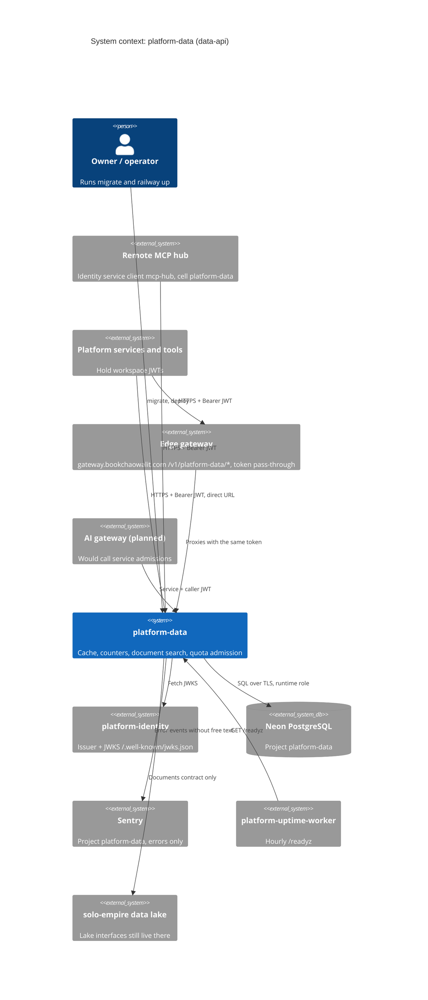

# 05 — C4 Context

Status: **done**

Sources: `README.md`, `docs/runtime.md`, `docs/CONTRACT-SURFACE.md`, `src/platform_data/__main__.py` (`JWT_JWKS_URL`),
`src/platform_data/_sentry.py`; Railway describe-service variable names (`DATABASE_URL`, `JWT_AUDIENCE`, `JWT_ISSUER`,
`JWT_JWKS_URL`, `PLATFORM_SYSTEM_WORKSPACE_ID`, `SENTRY_DSN`); ops record: book-platforms-status (2026-11-03) for identity issuer,
Neon project, Sentry project, uptime worker and MCP hub cell; platform-api-gateway `routes.json` + `README.md` @ `4a31ff5`
(route `platform-data` → `https://data-api-production-bf8a.up.railway.app`; added 2026-11-04).

## Open questions

- gateway มี route `platform-data` แล้ว (`routes.json` @ `4a31ff5`) แต่ direct URL ยังใช้ได้จนกว่าจะบันทึก cutover และ data ไม่เช็ค `X-Gateway-Assertion`: caller ตัวไหนย้ายมา gateway แล้ว และจะปิด direct URL เมื่อไร
- AI gateway (`platform-ai-gateway-api`) จะเป็น caller จริงหรือไม่ เป็น owner decision ที่ยังเปิด
