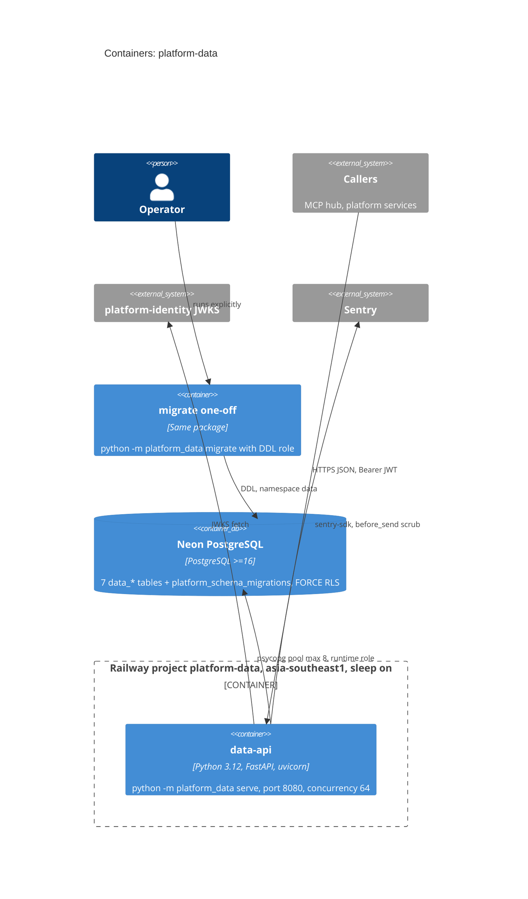

# 06 — C4 Container

Status: **done**

Sources: `Dockerfile` (CMD, `PORT=8080`, UID 65532), `src/platform_data/__main__.py` (`serve` / `migrate`, uvicorn limits),
`src/platform_data/migrations.py`, platform-backend-core @`21d5f44` `db.py` (pool `max_size=8`), `pyproject.toml`;
Railway describe-service (service `data-api`, region `asia-southeast1-eqsg3a`, `sleepApplication: true`, 1 replica).

## Open questions

- migrate one-off รันที่ไหนจริง (local กับ owner DSN หรือ Railway command override)? repo ไม่มี script/สคริปต์ release
- Neon region/compute size ไม่อยู่ใน repo หรือ ops record
