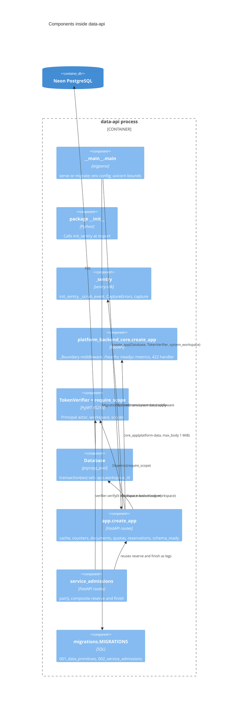

# 07 — C4 Component

Status: **done**

Sources: `src/platform_data/__init__.py`, `__main__.py`, `_sentry.py`, `app.py`, `service_admissions.py`, `migrations.py`;
platform-backend-core @`21d5f44` `http.py`, `auth.py`, `db.py`, `migrations.py` (installed copy pinned by `uv.lock`).

## Open questions

- ไม่มี
