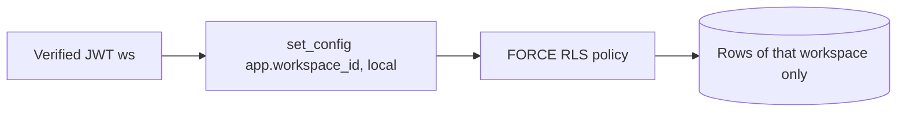

# ADR-0001 — PostgreSQL with FORCE RLS keyed by the signed `ws` claim

Status: **accepted (retro-documented)** · Date seen in code: 2026-10-15 (`8ecf228`)

## Context
หลาย workspace ใช้ service เดียวกัน และ README ห้ามให้ caller เลือก workspace เอง ("Signed JWT `ws` is the only workspace authority").

## Decision
- PostgreSQL >=16 เป็น store เดียวและเป็น concurrency boundary (`app.py` docstring "PostgreSQL is the concurrency/correctness boundary").
- ทุกตาราง tenant มี primary key นำด้วย `workspace_id`, `ENABLE` + `FORCE ROW LEVEL SECURITY` และ policy `workspace_isolation`
  `USING/WITH CHECK (workspace_id = current_setting('app.workspace_id'))`.
- core `Database.transaction(workspace)` ตั้ง `app.workspace_id` แบบ transaction-local จาก `Principal.workspace` เท่านั้น และ reset ตอนคืน connection.
- runtime role ต้องเป็น NOSUPERUSER NOBYPASSRLS; DDL แยก role (`migrate`).

## Consequences
- body/header ที่ส่ง workspace มาเองถูกปฏิเสธ (`extra='forbid'`).
- composite admission ต้องเปิด transaction แยกต่อ workspace (ไม่สลับ tenant ใน transaction เดียว).
- readiness ใช้ `UUID(int=0)` เป็น workspace context เพื่ออ่านเฉพาะ migration history/privilege.

## Evidence
`src/platform_data/migrations.py` (`_RLS`, `_SERVICE_ADMISSIONS`), `src/platform_data/app.py`, platform-backend-core @`21d5f44` `db.py`,
`README.md` ("Migration gate"), `tests/runtime/test_api.py::test_runtime_role_force_rls_and_cross_workspace_write`.
