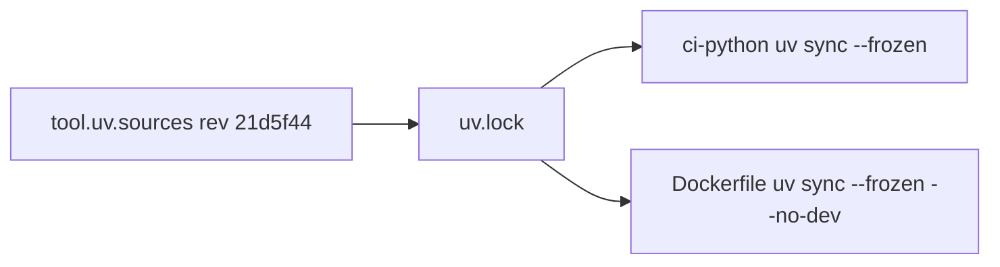

# ADR-0002 — Build on `platform-backend-core` pinned to a reviewed Git commit

Status: **accepted (retro-documented)** · Seen: `7ba94c3` (2026-10-24), repinned `a11747e` (2026-10-29)

## Context
JWT verification, DB transaction binding, readiness, HTTP boundary และ migration runner ใช้ร่วมกันทุก platform service
(runtime.md: "No copied auth/DB code"). core ไม่ได้อยู่บน PyPI.

## Decision
- dependency `platform-backend-core==0.1.0` จาก `[tool.uv.sources]` git `rev = 21d5f44d26220080cbed43b9807979dc84a8533a`, ล็อกใน `uv.lock`
  (กัน dependency confusion กับแพ็กเกจชื่อเดียวกันบน PyPI).
- CI และ Dockerfile ใช้ `uv sync --frozen` lock เดียวกัน; `tests/test_build_hygiene.py` ตรวจว่า lock กับ sources ตรงกัน.

## Consequences
- อัปเกรด core = เปลี่ยน rev + `uv lock` (เคยทำ 88306b2 → 21d5f44 เพื่อ Neon resume timeout ตาม commit message).
- เป็น "cells own their code" แต่ core ยังเป็น library ร่วม.

## Evidence
`pyproject.toml`, `uv.lock`, `Dockerfile`, `docs/runtime.md` ("Container image"), git log `f34aa6e`, `a11747e`.
