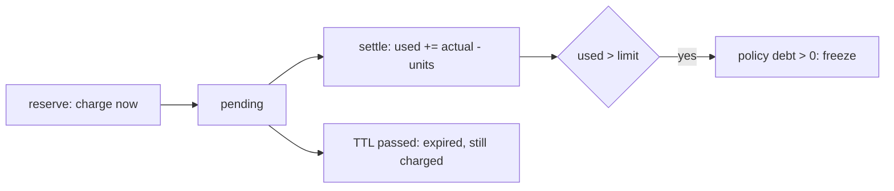

# ADR-0003 — Durable quota admission: charge at reserve, expiry stays charged, overrun becomes a debt freeze

Status: **accepted (retro-documented)** · Seen: `8ecf228`, `b6b6543` (2026-10-15)

## Context
admission ใช้กันก่อนเรียก provider ที่เสียเงิน; process หลาย replica ต้องไม่ overshoot และ restart ต้องไม่ลืม reservation.

## Decision
- reserve คิดหน่วยเข้า bucket ทันที ใต้ `SELECT ... FOR UPDATE` ของ policy และ advisory lock ต่อ idempotency key.
- idempotency key เดิม + payload เดิม = reservation เดิม; payload ต่าง = 409.
- TTL หมดไม่คืนหน่วย (`expired` ยังถูกคิด); release หลังหมดอายุคืนค่า `expired`; late settle ได้.
- actual เกิน limit → `debt` ถาวรบน policy ซึ่งบล็อกทุก admission รวม window ใหม่; ไม่มี API reset (ต้อง operator repair).
- composite: mapping commit ก่อน leg, global ก่อน tenant, leg key มาจาก mapping UUID; ความล้มเหลวบางส่วนไม่คืน global.

## Consequences
- เลือก hard ceiling มากกว่า auto-forgiveness (runtime.md); ต้องมี operator reconciliation และ retention job ในอนาคต.

## Evidence
`src/platform_data/app.py` (`reserve`, `finish`, `expire`, `available`), `src/platform_data/service_admissions.py`, `docs/runtime.md`,
`tests/runtime/test_api.py`, `tests/runtime/test_service_admissions.py`.
