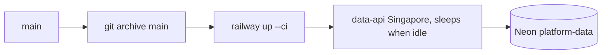

# ADR-0004 — Host on Railway serverless (Singapore) with per-service Neon, deployed by CLI

Status: **accepted (retro-documented)** · First deployment 2026-10-29 04:36 UTC

## Context
owner อนุมัติ deploy ทุก service ใหม่แบบ serverless (ops record: book-platforms-status (2026-11-03), 2026-10-29). Neon free quota นับต่อ project.

## Decision
- Railway project `platform-data`, service `data-api`, `asia-southeast1-eqsg3a`, 1 replica, `sleepApplication: true`, domain `data-api-production-bf8a.up.railway.app`.
- Neon project ของตัวเอง `platform-data`; secrets ใน Infisical `/platform-data` (ops record).
- deploy ด้วย `railway up --ci` จาก `git archive main` (ops record deploy recipe) — ไม่มี GitHub source link, จึงไม่มี Wait-for-CI.
- ย้าย region us-east4 → Singapore วันเดียวกัน (deployments 2026-10-29 04:36/04:54 = us-east4, 05:24 = ทั้งสอง, 05:34 = Singapore).

## Consequences
- cold start + Neon resume (core pool wait 20 s, connect timeout 15 s).
- CI ไม่ได้ gate deploy; Railway meta ไม่มี commit SHA (ดู 18, 22).

## Evidence
Railway API list-deployments / describe-service (2026-11-03); ops record: book-platforms-status (2026-11-03); platform-backend-core @`21d5f44` `db.py`.
