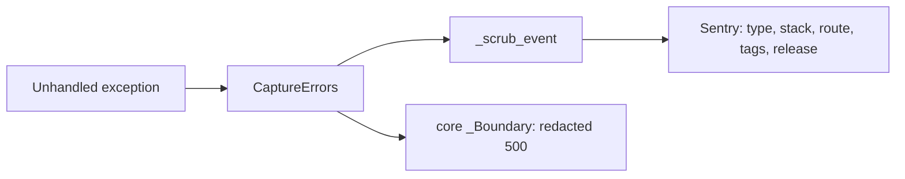

# ADR-0005 — Sentry errors only, no free text leaves the process

Status: **accepted (retro-documented)** · Seen: `988d86c` (2026-10-29) → `869305b` (2026-11-03, PR #18)

## Context
PR #5–#17 พยายาม scrub ข้อความด้วย regex/span แล้วโดน bypass ใหม่ทุกรอบ (docstring `_sentry.py`).

## Decision
- `SENTRY_DSN` ว่าง = no-op. เปิดแล้ว: `traces_sample_rate=None`, `trace_propagation_targets=[]`, `send_default_pii=False`,
  `include_local_variables=False`, `max_request_body_size="never"`, logging integration ปิดทั้ง event และ breadcrumb.
- `before_send=_scrub_event` ลบ exception `value`, `message`, `logentry`, `breadcrumbs`, `extra`, `user`, request เหลือแค่ `method`, ลบ `dynamic_sampling_context`.
- `CaptureErrors` เป็น middleware ชั้นในสุด เพราะ core `_Boundary` กลืน exception เป็น 500.

## Consequences
- debug จาก Sentry ได้แค่ type + stack; ต้องดู Railway logs ประกอบ (owner revert ได้ตาม ops record).

## Evidence
`src/platform_data/_sentry.py`, `src/platform_data/app.py`, `tests/test_sentry.py`, `tests/runtime/test_sentry_boundary.py`, git log PR #5–#18.
