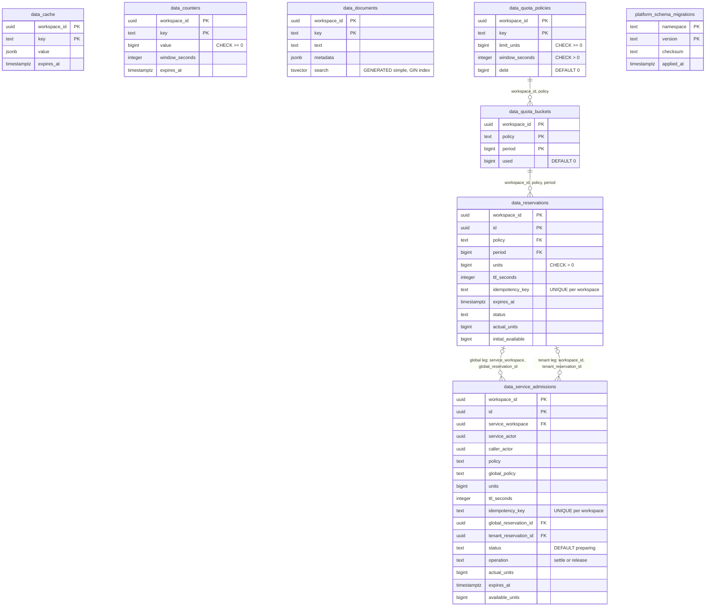

# 09 — ERD

Status: **done**

Sources: `src/platform_data/migrations.py` (`001_data_primitives`, `002_service_admissions`); platform-backend-core @`21d5f44`
`migrations.py` (`platform_schema_migrations`).

## RLS / role notes

- ทั้ง 7 ตาราง `data_*`: `ENABLE` + `FORCE ROW LEVEL SECURITY`, policy `workspace_isolation` USING + WITH CHECK บน `app.workspace_id`
- `platform_schema_migrations` ไม่มี RLS (shared release metadata, ไม่มีข้อมูล tenant — comment ใน `schema_ready`)
- runtime role: USAGE schema, SELECT/INSERT/UPDATE/DELETE บน 7 ตาราง, SELECT บน migrations (runtime.md); readiness ตรวจทีละ privilege
- Index: `data_documents_search` (GIN), `data_reservations_policy (workspace_id, policy, status, expires_at)`, `data_cache_expiry (workspace_id, expires_at)`
- FK ของ global leg ชี้ข้าม workspace (`service_workspace` = system workspace) ภายใต้ RLS — row ของ reservation ถูกเขียนใน transaction ของ system workspace

## Open questions

- ชื่อ runtime role ใน Neon `platform-data` ไม่อยู่ใน repo/ops record (security ใช้ `security_runtime`)
- ไม่มี retention: ทุกตารางโตตลอด ไม่มีขนาดข้อมูลจริงให้ดู
