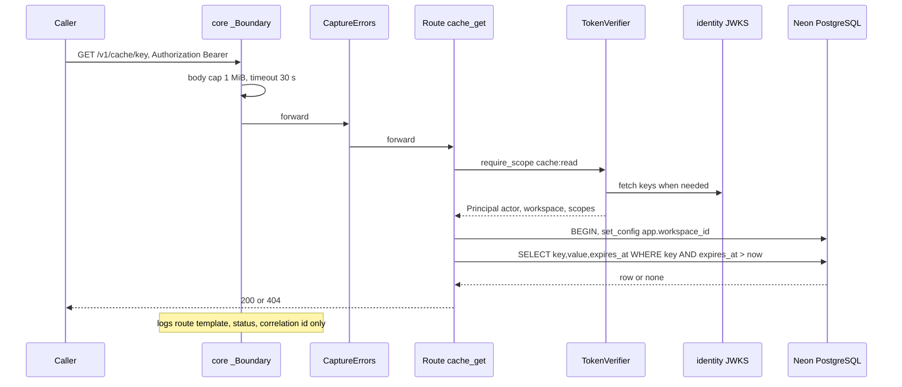
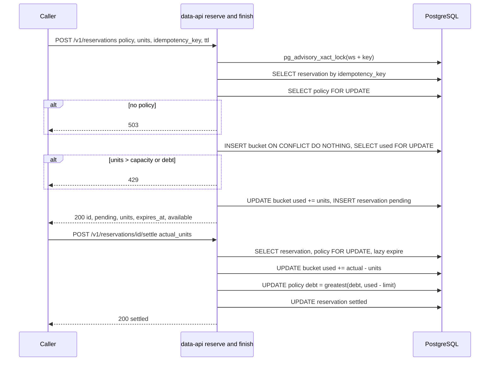
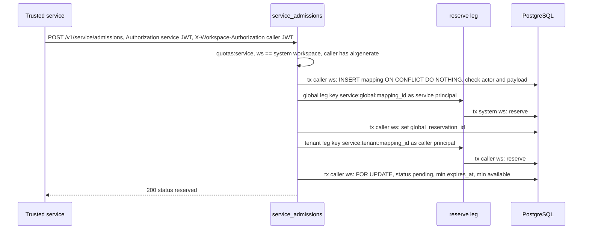

# 10 — Sequences

Status: **done** — 3 path สำคัญ

## 1. Authenticated request (any `/v1/*` route), e.g. cache GET

## 2. Reserve → settle (single workspace)

## 3. Composite service admission

Sources: `src/platform_data/app.py`, `src/platform_data/service_admissions.py`, `src/platform_data/_sentry.py`;
platform-backend-core @`21d5f44` `http.py` (`_Boundary`, `require_scope`), `auth.py`, `db.py`.

## Open questions

- ไม่มี
