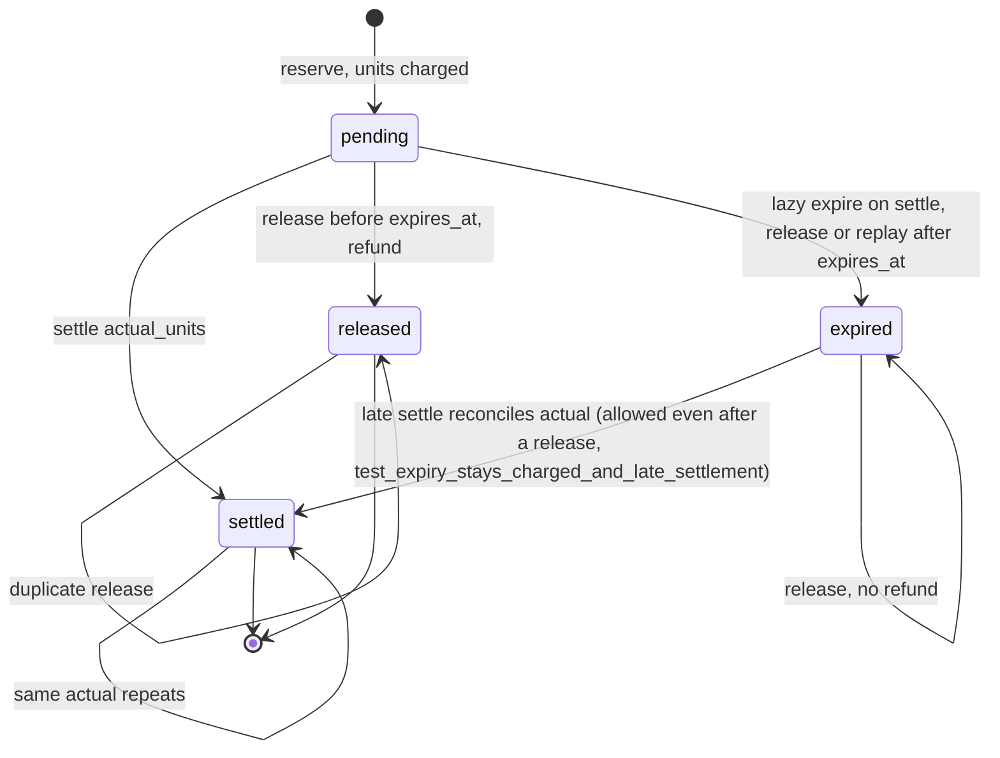
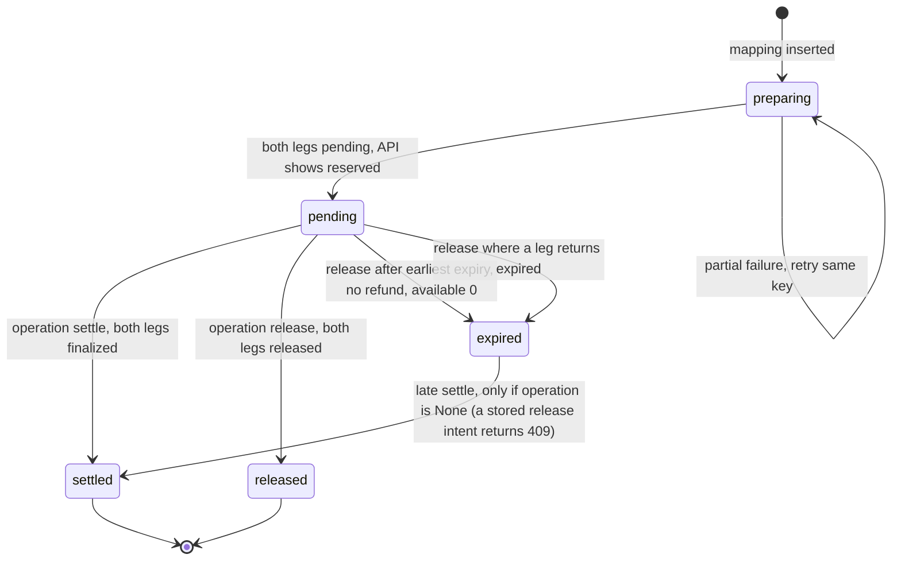
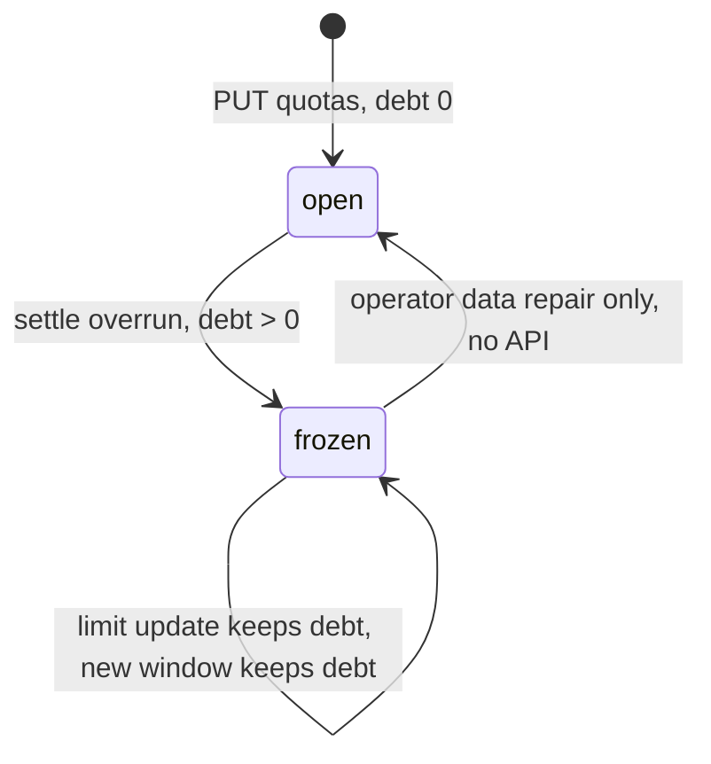

# 11 — State machines

Status: **done**

## `data_reservations.status`

ข้อห้าม: settle หลัง released หรือ actual ต่าง = 409; release หลัง settled = 409 (`finish`).

## `data_service_admissions.status` (+ `operation`)

`preparing` + settle/release = 503; reserve replay หลังมี `operation` = 409.

## Quota policy debt

Sources: `src/platform_data/migrations.py` (CHECK constraints), `src/platform_data/app.py` (`expire`, `finish`, `available`),
`src/platform_data/service_admissions.py` (`reserve`, `finish`, `response`), `docs/runtime.md`.

## Open questions

- ขั้นตอน operator "explicit reviewed data repair" สำหรับล้าง debt ไม่มี runbook/สคริปต์ใน repo
