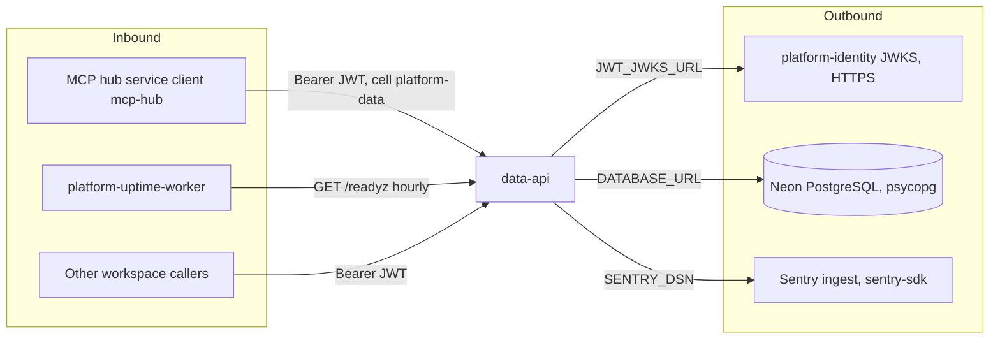

# 12 — API & integrations

Status: **done** — bounds และ semantics เต็มอยู่ใน [runtime.md](../runtime.md) (reused) ตารางนี้ดึงจาก router code

## Routes

| Method | Path | Scope / auth | Idempotency | Main errors |
|---|---|---|---|---|
| GET | `/healthz` | none (core) | safe | — |
| GET | `/readyz` | none (core); DB + `data_schema` check | safe | 503 `unavailable` |
| GET | `/metrics` | none (core) | safe | — |
| PUT | `/v1/cache/{key}` | `cache:write` | replace (last PUT wins) | 422 |
| GET | `/v1/cache/{key}` | `cache:read` | safe, never extends TTL | 404 |
| DELETE | `/v1/cache/{key}` | `cache:write` | idempotent `{deleted:true}` | — |
| POST | `/v1/counters/{key}/increment` | `counters:write` | **not** idempotent (adds `amount`) | 409 window differs |
| PUT | `/v1/documents/{key}` | `documents:write` | replace | 422 |
| DELETE | `/v1/documents/{key}` | `documents:write` | idempotent | — |
| GET | `/v1/documents?q&limit&offset` | `documents:read` | safe | 422 |
| PUT | `/v1/quotas/{key}` | `quotas:write` | upsert limit; window immutable | 409 |
| POST | `/v1/reservations` | `quotas:reserve` | `idempotency_key` (advisory lock per ws+key) | 503 no policy, 429, 409 payload differs |
| POST | `/v1/reservations/{id}/settle` | `quotas:settle` | same `actual_units` repeats safely | 404, 409 |
| POST | `/v1/reservations/{id}/release` | `quotas:settle` | duplicate release safe | 404, 409 |
| POST | `/v1/service/admissions` | `quotas:service` (ws = system) + `X-Workspace-Authorization` with `ai:generate` | `idempotency_key` per caller workspace; leg keys from mapping UUID | 503 not configured, 401, 403, 409 |
| POST | `/v1/service/admissions/{id}/settle` | same pair, same actors | durable `operation` intent | 503 preparing, 404, 403, 409 |
| POST | `/v1/service/admissions/{id}/release` | same pair, same actors | durable intent; post-expiry no refund | 404, 403, 409 |

ทุก route `/v1/*`: body cap 1 MiB, `extra='forbid'`, validation error = generic 422 `invalid request`, unhandled = 500 `internal server error`, timeout 504 (core `_Boundary` 30 s).

## Integrations

ไม่มี webhook, ไม่มี provider SDK, ไม่มี paid call (README "Boundary"). Lake interfaces (`data.cli.ingest`, `data.object-store.*`) อยู่ใน
solo-empire ดู [CONTRACT-SURFACE.md](../CONTRACT-SURFACE.md)

Live probe 2026-11-03: `/healthz` 200 `{"status":"ok"}`, `/readyz` 200 `{"status":"ready"}` (0.93 s), `/metrics` 200 (public), `/v1/cache/x` ไม่มี token 401.

Sources: `src/platform_data/app.py`, `src/platform_data/service_admissions.py`, platform-backend-core @`21d5f44` `http.py`,
`docs/runtime.md`, `README.md`, Railway variable names; ops record: book-platforms-status (2026-11-03) (MCP hub cell, uptime worker); live curl.

## Open questions

- data มี route บน edge gateway `gateway.bookchaowalit.com` หรือไม่? ops record ไม่ระบุ
- `JWT_AUDIENCE` ที่ตั้งบน Railway เป็นค่าอะไร (`data-api` ตาม ops record หรือ `platform-api` ตาม runtime.md)? verifier เดียวใช้กับทั้งสอง token
- FastAPI default `/docs` และ `/openapi.json` เปิดสาธารณะบน live (probe 2026-11-03: 200 ทั้งคู่) — ตั้งใจหรือไม่? (ดู 13)
