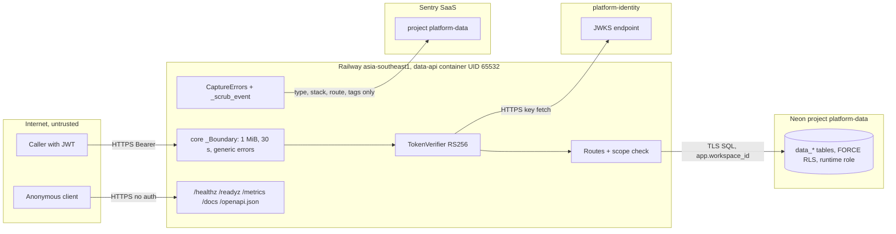

# 13 — Threat model

Status: **done**

## DFD with trust boundaries

ไม่มี edge gateway ในภาพเพราะไม่ทราบว่ามี route (open question). Railway domain สาธารณะเข้าถึงตรงได้ (probe 2026-11-03).

## STRIDE per element

| Element | Threat | Existing mitigation (code) | Gap |
|---|---|---|---|
| Caller → API | **S** forged token | RS256 only, `crit` rejected, required `sub ws iat exp jti iss aud`, strict aud, lifetime ≤ 3600 s, `del`/`obo` rejected (core `auth.py`) | no revocation / jti replay store (core comment "cannot enforce revocation") |
| Caller → API | **T** workspace spoof in body/header | `extra='forbid'`; workspace only from signed `ws`; composite caller from separately verified JWT | — |
| Routes | **E** scope escalation | exact `require_scope` per route; composite checks `quotas:service` + system ws + `ai:generate` + actor binding | one verifier (same issuer/audience) for service and caller token |
| Routes | **D** resource abuse | 1 MiB body, 64 KiB cache, 200k chars docs, limit ≤ 100, offset ≤ 10000, uvicorn concurrency 64, 30 s timeout, statement_timeout 10 s | no rate limit per workspace; counters/cache/doc rows unbounded in count; no retention |
| Routes | **I** injection / error leaks | parameterized SQL, `plainto_tsquery`, NUL rejected, generic 422/500, DSN/token never printed (`__main__`) | — |
| Unauth endpoints | **I** info disclosure | `/metrics` route templates + counts only; `/readyz` status word only | `/metrics`, `/docs`, `/openapi.json` public on live (200) — exposes full route/schema map |
| Neon | **T/I** cross-tenant read/write | FORCE RLS USING + WITH CHECK, runtime NOSUPERUSER NOBYPASSRLS, `app.workspace_id` transaction-local and reset | runtime role name/grants in Neon not verifiable from repo |
| Neon | **R** accounting disputes | reservations/buckets retained, debt never auto-cleared | no audit event to security-api for operator debt repair |
| Identity JWKS | **S/D** key fetch | HTTPS URL configured explicitly, core bounded refresh, fail closed, redirects blocked (`auth.py` redirect handler) | if identity down and cache cold → 401 for all |
| Sentry egress | **I** PII/secret leak | no free text, no locals, no body/headers/user, no tracing/propagation (`_sentry.py`) | none known; debugging context reduced |
| Container / supply chain | **T** dependency confusion | core from pinned git commit, `uv sync --frozen`, SHA-pinned actions, shared `security` workflow | Railway builder `RAILPACK` may not use the reviewed Dockerfile (16) |
| Deploy path | **T** unreviewed code to prod | PR + CI used in practice | no branch protection/ruleset; `railway up` from local archive not tied to CI result |

Sources: `src/platform_data/app.py`, `service_admissions.py`, `migrations.py`, `_sentry.py`, `__main__.py`, `Dockerfile`,
`.github/workflows/check.yml`, platform-backend-core @`21d5f44` `auth.py`, `db.py`, `http.py`; Railway describe-service;
`gh api .../branches/main/protection` (404 not protected), rulesets empty; live probe 2026-11-03.
Central reference: [ATTACK-PATH-DIAGRAMS.md](https://github.com/bookchaowalit/architecture-docs/blob/main/docs/architecture/ATTACK-PATH-DIAGRAMS.md) (ไม่มีส่วนของ platform-data).

## Open questions

- ตั้งใจเปิด `/docs`, `/openapi.json`, `/metrics` สาธารณะหรือไม่?
- ควรมี gateway origin lock (`X-Gateway-Edge`) แบบบริการอื่นหรือไม่?
- ใครถือ `quotas:service` ได้ใน identity — ถ้ารั่ว ผู้ถือจะสร้าง admission แทน caller ใดก็ได้ที่ส่ง caller JWT มา
