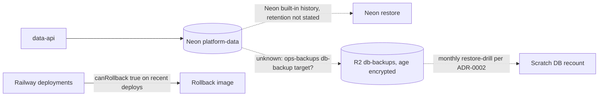

# 14 — Backup & DR

Status: **done** — แต่ backup coverage ของ Neon `platform-data` **ยืนยันไม่ได้** จาก repo

## Data inventory

| Data | Where | Criticality | Rebuildable? |
|---|---|---|---|
| `data_cache` | Neon `platform-data` | low (TTL ≤ 1 day) | yes, callers refill |
| `data_counters` | Neon | medium (window counts) | partly, reset at window end |
| `data_documents` | Neon | depends on caller; only copy here | unknown |
| `data_quota_policies` (+ `debt`) | Neon | high (limits + freeze marker) | from operator config, debt not |
| `data_quota_buckets`, `data_reservations`, `data_service_admissions` | Neon | high (accounting history) | no |
| `platform_schema_migrations` | Neon | high for readiness | yes, from `MIGRATIONS` |
| Secrets (`DATABASE_URL`, JWT vars, `SENTRY_DSN`, `PLATFORM_SYSTEM_WORKSPACE_ID`) | Railway vars + Infisical `/platform-data` | high | from Infisical |
| Code / image | GitHub `main`; Railway snapshots | — | yes |

Sources: `src/platform_data/migrations.py`, `docs/runtime.md` ("Staged rollback and reconciliation"); Railway list-deployments
(`canRollback: true` from 2026-10-29 07:53 onward); ops record: book-platforms-status (2026-11-03) (own Neon project, Infisical path);
central [ADR-0002](https://github.com/bookchaowalit/architecture-docs/blob/main/docs/architecture/decisions/ADR-0002-production-baseline-monitoring-backups.md)
(Neon databases backed up by `ops-backups/db-backup` with a `db_backup` role per Neon project — ไม่ได้ระบุว่ารวม `platform-data`).

## Restore reality (จาก runtime.md)

- ก่อนเปิด consumer: เก็บ image digest เดิม, `uv.lock`, release manifest และ "a tested database backup"
- rollback: หยุด admission ใหม่, ปิด consumer adapter, ห้าม drop table/down migration; ถ้า version เก่าไม่เข้าใจ schema → หยุดและ recover ลง DB ใหม่
- reconcile pending/expired กับ provider ก่อนปล่อย charge

## RTO / RPO

- RTO: **not defined**
- RPO: **not defined**

## Open questions

- Neon `platform-data` อยู่ในรายการ target ของ `ops-backups/db-backup` และ restore-drill หรือยัง (มี `db_backup` role หรือไม่)?
- Neon history retention ของ free project นี้กี่ชั่วโมง/วัน?
- "tested database backup" ที่ runtime.md เรียกร้องก่อนเปิด consumer ได้ทำแล้วหรือไม่ — ไม่มีหลักฐานใน repo
