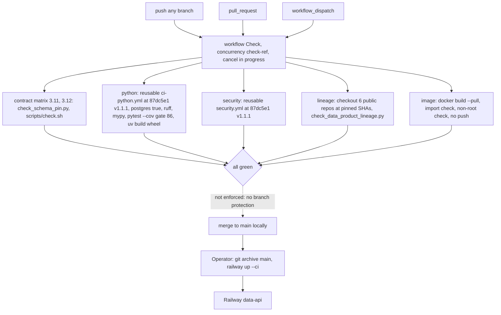

# 15 — CI/CD pipeline

Status: **done** — workflow เดียว `Check` (`.github/workflows/check.yml`), GitHub-hosted (repo public). CD ไม่ได้อยู่ใน workflow

`scripts/check.sh` รัน `check.py`, `check_schema_pin.py`, `check_data_product_lineage.py` และ `python3 -m unittest discover -s tests` (offline; runtime tests ต้องใช้ PostgreSQL จึงรันใน job `python`). ไม่มี `needs:` ระหว่าง job — ทั้ง 5 รันขนาน

ผลจริง (`gh run list -R bookchaowalit-backend/platform-data -L 200`): 82 runs; `main` 27 success / 2 failure (`0a0035f`, `b5d87d9` 2026-10-13
หลัง rename, แก้ใน `63198ff`); branch failures เฉพาะ `fix/sentry-hardening-port` 3 และ `sentry-hardened-scrubber` 1. Workflow `Shared runtime`
เก่าเลิกใช้หลัง `201b8b0` (รวมเข้า job `python` ใน `7ba94c3`).

Sources: `.github/workflows/check.yml`, `scripts/check.sh`, `pyproject.toml`, `README.md` ("Local verification"), `gh run list` output 2026-11-03;
ops record: book-platforms-status (2026-11-03) (deploy recipe `railway up --ci` from `git archive main`).

## Open questions

- ไม่ได้อ่านเนื้อใน `platform-ci-workflows` `ci-python.yml` / `security.yml` @`87dc5e1` ใน repo นี้ — รายการ step ข้างบนมาจาก comment ใน `check.yml`
- ควรมี deploy job (หรือ Railway GitHub source + Wait for CI) แทน CLI หรือไม่?
