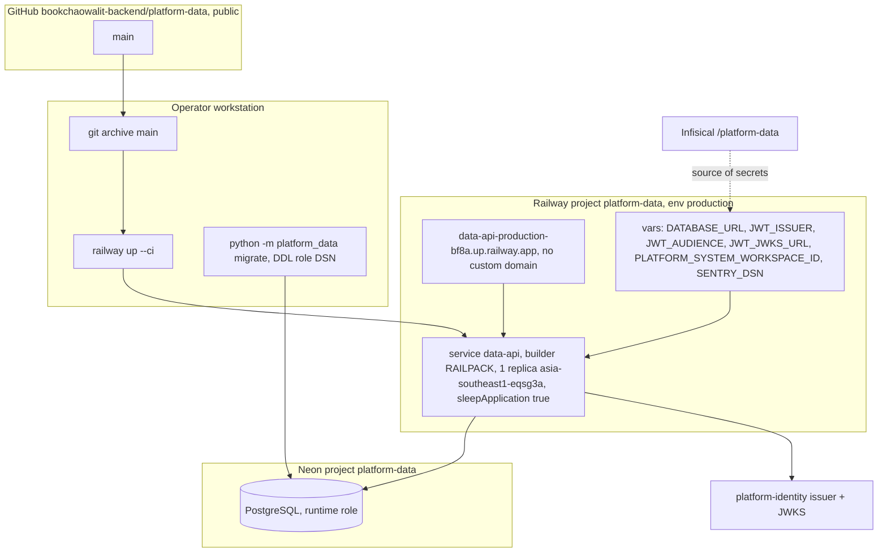

# 16 — Deployment

Status: **done**

| Item | Value | Source |
|---|---|---|
| Health | `/healthz` 200 `{"status":"ok"}` (process only) | core `http.py`; probe 2026-11-03 |
| Readiness | `/readyz` 200 `{"status":"ready"}` — DB `SELECT 1` + migration history/checksums + per-table DML privilege in one query | `app.py` `schema_ready`; probe 0.93 s |
| Railway healthcheck path | not present in service config | Railway describe-service |
| Serverless | sleeps when idle; first request wakes service, Neon resume ~6–9 s covered by pool wait 20 s / connect 15 s | describe-service; ops record; core `db.py` |
| Start command | `Dockerfile` CMD `python -m platform_data serve` (port 8080, UID 65532) — but Railway builder is `RAILPACK` | `Dockerfile`; describe-service |
| Deploy history | 22 deployments 2026-10-29 → 2026-11-03, latest `bd3f2796` SUCCESS 2026-11-03 04:22 UTC; first 3 in us-east4, moved to Singapore 05:24–05:34 | Railway list-deployments |
| Region | `asia-southeast1-eqsg3a` | describe-service; ops record |
| Secrets | Infisical `/platform-data`, Sentry project `platform-data` | ops record: book-platforms-status (2026-11-03) |

Sources: Railway API describe-service / list-deployments (2026-11-03), `Dockerfile`, `src/platform_data/__main__.py`, `src/platform_data/app.py`,
platform-backend-core @`21d5f44` `http.py`, `db.py`; ops record: book-platforms-status (2026-11-03); live curl.

## Open questions

- Railway build ใช้ `Dockerfile` ของ repo หรือ Railpack auto-detect? ถ้า Railpack ใช้ start command อะไร และ image ยังรันเป็น non-root/ไม่มี dev extras หรือไม่
- ควรตั้ง Railway healthcheck `/healthz` (แบบ payment) หรือไม่
- migration ล่าสุดบน Neon ถูก apply เมื่อไหร่และโดยใคร (readiness 200 แปลว่า `001` + `002` ตรง checksum)
