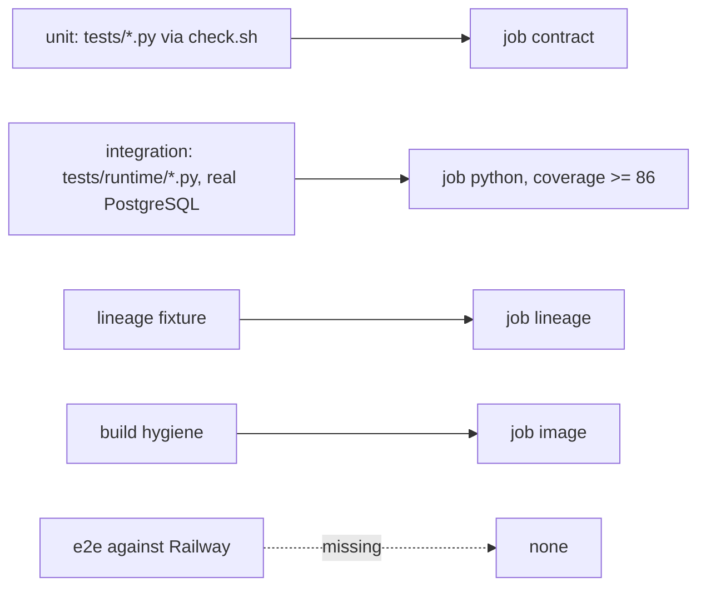

# 17 — Test coverage matrix

Status: **done**

ระดับ: **unit** = offline `unittest` (`scripts/check.sh`); **integration** = pytest กับ PostgreSQL จริง + JWT RSA จริง (`tests/runtime/`,
ต้องมี `PLATFORM_TEST_DSN`, ไม่มี skip); **e2e** = ต่อ service ที่ deploy แล้ว — ไม่มีใน repo

| Feature | Unit | Integration | E2E | Notes |
|---|---|---|---|---|
| Cache put/get/delete, TTL, 64 KiB, NUL/unicode | — | `test_api.py` (3 tests) | — | |
| Counters atomic, window, expiry | — | `test_api.py` (2) | — | |
| Document search, isolation, paging | — | `test_api.py::test_search_plain_text_isolation_and_page` | — | Thai segmentation out of scope by design |
| Quota policy + reservations (overshoot, idempotency, expiry, debt, restart, multi-process) | — | `test_api.py` (8) | — | |
| Composite service admission | — | `test_service_admissions.py` (19) | — | no real caller exists |
| Auth: 401/403, cross-tenant | — | `test_api.py::test_missing_policy_auth_and_caller_authority`, `test_restart_and_cross_tenant_reservation`; `test_service_admissions.py::test_verifies_both_signed_tokens_and_system_workspace` | — | JWKS mode not tested here (PEM in tests) |
| FORCE RLS + runtime role | — | `test_api.py::test_runtime_role_force_rls_and_cross_workspace_write` | — | |
| Readiness / migrations | — | `test_api.py` (2), `test_service_admissions.py` (3) | — | |
| CLI serve/migrate config | — | `test_api.py::test_cli_missing_configuration_fails_safely`, `test_cli_explicit_migrate_is_repeatable` | — | |
| Sentry scrub + CaptureErrors | `test_sentry.py` (12) | `test_sentry_boundary.py` (2, real sentry client) | — | |
| Contract / schema pin / registry drift | `test_contract_check.py` (19), `test_drift_checks.py` (17) | — | — | |
| BOO-152 lineage | `test_data_product_lineage.py` | CI job `lineage` checks pinned public repos | — | runtime lineage `unverified` |
| Build hygiene (Dockerfile, lock, SHA pins) | `test_build_hygiene.py` (9) | CI job `image` builds + runs | — | |
| `/healthz`, `/metrics`, `/docs` | — | — (core) | — | **gap**: no smoke test after deploy |
| Live deployment | — | — | — | **gap**: no post-deploy smoke / contract test against Railway |

Coverage gate: `coverage-threshold: "86"` (measured 86.97% 2026-10-24, ADR-0004 ratchet) over `src/platform_data` + `scripts`.
runtime.md บันทึก local run 114 passed, coverage 87% (2026-10-29).

Sources: `tests/**/*.py` (test function names), `.github/workflows/check.yml`, `pyproject.toml` (`[tool.coverage.run]`), `docs/runtime.md`.

## Open questions

- ไม่ได้รัน suite ในงานนี้ ตัวเลข coverage ล่าสุดบน CI ต้องดูจาก log ของ run `0e724ac`
