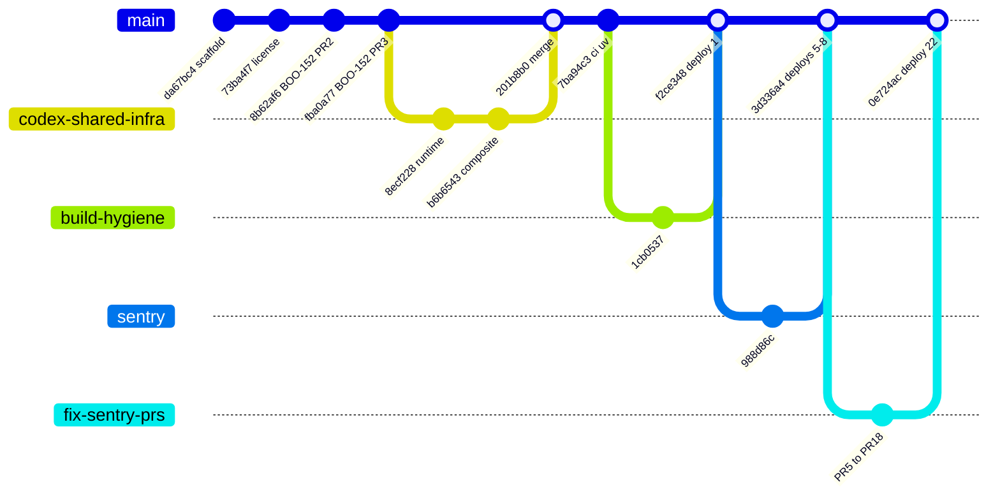
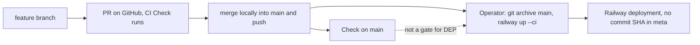

# 18 — Git & release workflow

Status: **done**

ข้อเท็จจริงจาก git/gh:
- `main` ไม่มี branch protection (`gh api .../branches/main/protection` → 404) และไม่มี ruleset
- PR 18 รายการ: merged 16, open 1 (#4 `sentry-hardened-scrubber`, ถูก supersede), closed 1 (#1 — แต่ runtime เข้าทาง merge `201b8b0` ของ branch rebased)
- บาง merge ไม่ผ่าน PR (`3d336a4`, `0bf19a5`, `174ebf0`, `f2ce348` เป็น local merge ของ branch)
- deploy เกิดภายใน 0–3 นาทีหลัง merge (22 deploys; ดูการจับคู่ใน 22)

Sources: `git log origin/main`, `gh pr list --state all`, `gh api repos/bookchaowalit-backend/platform-data/branches/main/protection`,
`gh api .../rulesets`, Railway list-deployments; ops record: book-platforms-status (2026-11-03) (deploy recipe).

## Open questions

- ควรเปิด branch protection / required checks สำหรับ `main` หรือไม่ (repo public, owner คนเดียว)?
- PR #4 ค้างเปิด — ปิดได้หรือไม่
