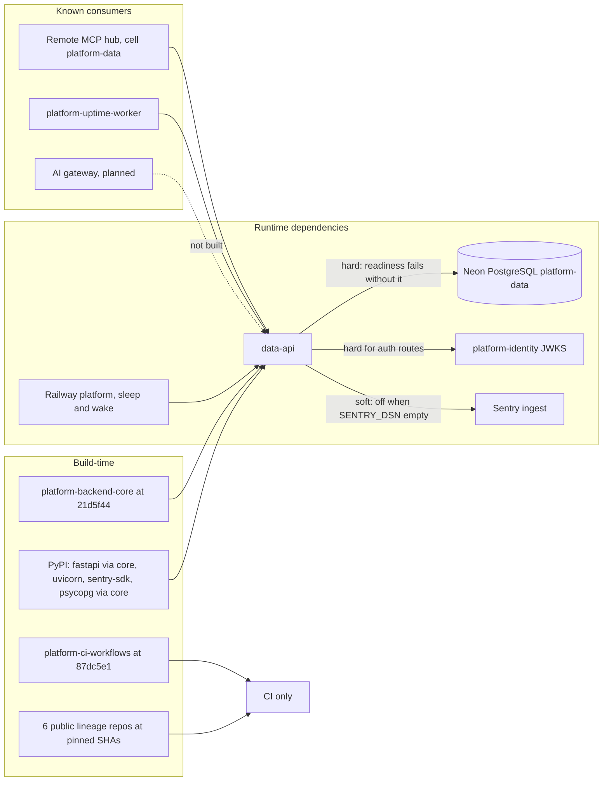

# 19 — Service dependency map

Status: **done**

| Dependency | Kind | Failure effect (from code) |
|---|---|---|
| Neon PostgreSQL | hard | `/readyz` 503; routes fail closed with generic errors |
| platform-identity JWKS | hard for `/v1/*` | token verification fails → 401 (core fail-closed) |
| Sentry | soft | no-op without DSN; send errors do not affect requests |
| platform-backend-core | build | pinned commit via `uv.lock` |
| `contract.json` `depends_on: security, observability` | declared | no runtime call to security or observability services in code |

Sources: `pyproject.toml`, `uv.lock` (core rev), `src/platform_data/*.py`, `.github/workflows/check.yml`, `contract.json`, Railway variable
names; ops record: book-platforms-status (2026-11-03) (MCP hub, uptime worker, AI gateway status).

## Open questions

- มี service อื่นใน platform ที่เรียก data-api จริง (นอก MCP hub) หรือไม่ — ไม่พบใน repo นี้
- `depends_on: security` หมายถึง audit event ในอนาคตหรือไม่? ปัจจุบันไม่มีการส่ง audit
