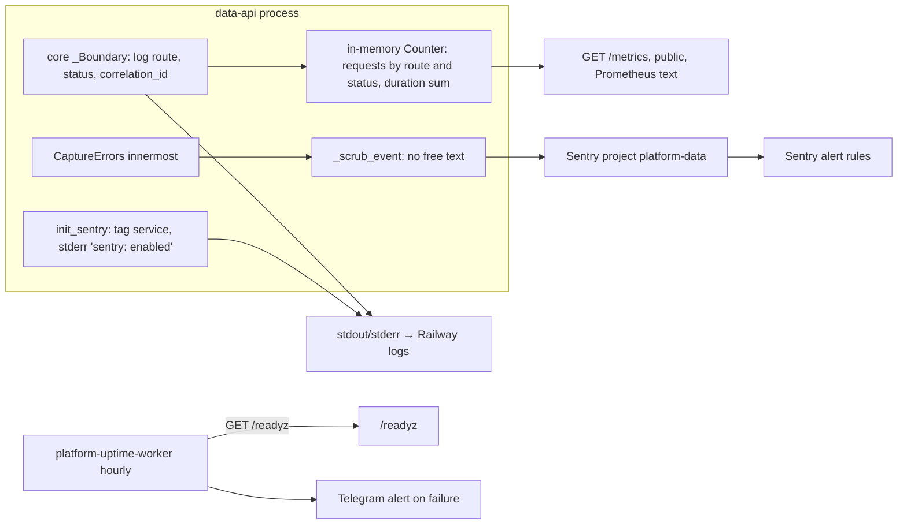

# 20 — Observability

Status: **done**

| Signal | Producer | What is watched | Who sees |
|---|---|---|---|
| Error events | `_sentry.py` + `CaptureErrors` (unhandled, `handled=False`) | exception type, stack, route, tags `service`, release `RAILWAY_GIT_COMMIT_SHA`/`SENTRY_RELEASE` | Sentry `platform-data` (org personal-yu0) |
| Request log | core `_Boundary` `_LOG.info` | route template, status, correlation id; access log off in uvicorn | Railway logs |
| Metrics | core `/metrics` | `platform_http_requests_total{route,status}`, duration sum — per process, reset on restart/sleep | nobody scrapes (ops record: scraper would keep sleeping services awake) |
| Readiness | core `/readyz` + `schema_ready` | DB, migration checksums, DML grants | uptime worker hourly, Telegram |
| Tracing | disabled (`traces_sample_rate=None`); Railway tracing disabled | — | — |

Live 2026-11-03: `/metrics` returned 3 lines after wake (`/healthz` 1, `/readyz` 2) — confirms per-process in-memory counters.

Sources: `src/platform_data/_sentry.py`, `src/platform_data/app.py`, `src/platform_data/__main__.py` (`access_log=False`), platform-backend-core
@`21d5f44` `http.py`; Railway describe-service (`tracingEnabled: false`); ops record: book-platforms-status (2026-11-03) (uptime worker hourly
`/readyz`, Sentry project, observability decision pending); central [ADR-0002](https://github.com/bookchaowalit/architecture-docs/blob/main/docs/architecture/decisions/ADR-0002-production-baseline-monitoring-backups.md) (Telegram alert path).

## Open questions

- `RAILWAY_GIT_COMMIT_SHA` ว่างเมื่อ deploy ด้วย CLI upload หรือไม่? ถ้าว่างและไม่ตั้ง `SENTRY_RELEASE` event จะไม่มี release
- Sentry alert rule ของ project `platform-data` ส่งไปที่ไหน (email/Telegram)? ไม่อยู่ใน repo
- ไม่มี heartbeat (ไม่มี scheduled job ใน service นี้)
