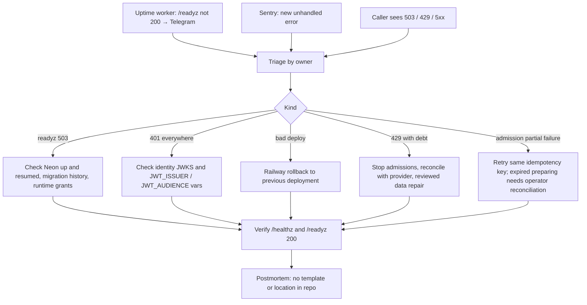

# 21 — Incident response

Status: **done** — ไม่มี RUNBOOK.md ใน repo; flow นี้ประกอบจาก alert channel ที่มีจริงและ rollback rules ใน [runtime.md](../runtime.md) (reused)

กฎจาก runtime.md ("Staged rollback and reconciliation"):
- ก่อน rollback image: หยุด admission ใหม่ ปิด consumer adapter
- ห้าม drop table, ห้าม down migration, ห้ามลบ reservation, ห้ามสลับ consumer ไปใช้ counter ใน process
- ถ้า version เก่าไม่เข้าใจ schema/checksum → หยุด service และ recover ลง DB ใหม่ให้ operator ตรวจ
- debt repair / destructive restore ต้องเป็น reviewed operator action แยก

Sources: `docs/runtime.md`, `src/platform_data/app.py` (status codes), `src/platform_data/service_admissions.py`, Railway list-deployments
(`canRollback`), ops record: book-platforms-status (2026-11-03) (uptime worker, Sentry, deploy recipe), central
[ADR-0002](https://github.com/bookchaowalit/architecture-docs/blob/main/docs/architecture/decisions/ADR-0002-production-baseline-monitoring-backups.md).

## Open questions

- ไม่มี incident record / postmortem location สำหรับ platform service — จะเก็บที่ไหน?
- ใครรับ Sentry alert และมี severity/SLA หรือไม่?
- Railway rollback คืน image เก่าแต่ไม่คืน env vars/DB — ขั้นตอนสำหรับ migration ที่ apply แล้วไม่มีเขียนไว้นอกจาก "keep stopped"
