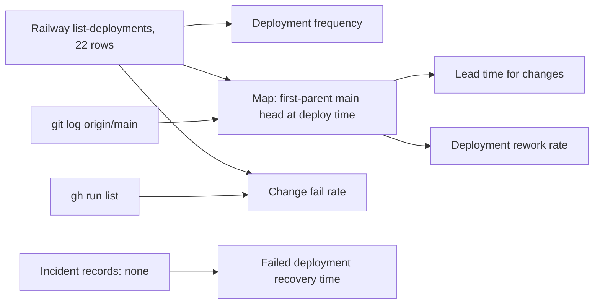

# 22 — DORA metrics

Status: **done** (window 90 วัน 2026-08-05 → 2026-11-03; recovery time = cannot compute; deploy ↔ commit mapping = **inferred**)

Deploy ทั้งหมดเป็น `railway up --ci` จาก `git archive main` (ops record: book-platforms-status (2026-11-03)). ผลคือ:
- git/gh **แสดงได้**: commit time, PR merge time, CI result ต่อ commit
- git/gh **แสดงไม่ได้**: deploy เกิดเมื่อไร, deploy commit ไหน — ไม่มี GitHub Deployment record (`gh api .../deployments` = 0) และ Railway
  deployment meta ไม่มี commit SHA (CLI upload). จึงใช้ Railway API เป็นแหล่ง deploy และจับคู่ "deployed SHA = first-parent head ของ `main` ณ เวลา deploy"



## Deployments (Railway, UTC) and inferred head

| # | Created | Status now | Inferred `main` head | Note |
|---|---|---|---|---|
| 1 | 2026-10-29 04:36 | REMOVED | `f2ce348` build hygiene | us-east4 |
| 2 | 10-29 04:54 | REMOVED | `174ebf0` core pin 88306b2 | us-east4 |
| 3 | 10-29 05:24 | REMOVED | `0bf19a5` core pin 21d5f44 | us-east4 + Singapore |
| 4 | 10-29 05:34 | REMOVED | `0bf19a5` (same) | region move to Singapore |
| 5 | 10-29 07:18 | REMOVED | `3d336a4` Sentry opt-in | |
| 6–7 | 10-29 07:45, 07:53 | REMOVED | `3d336a4` (same) | no new commit (config change, assumed) |
| 8 | 10-30 18:47 | REMOVED | `3d336a4` (same) | `reason: redeploy` |
| 9–22 | 11-02 17:09 → 11-03 04:22 | 13 REMOVED, #22 SUCCESS | PR #5 `0d02f56` … PR #18 `0e724ac` | one deploy per Sentry PR, 0–3 min after merge |

```bash
# deploys: Railway MCP list-deployments projectId=3d87a1d8-23d2-4cbe-ad8e-025b0236fb10 limit=50 → createdAt list in deploys.txt
while read t; do git log --first-parent origin/main --before="$t" -1 --format="%h $t"; done < deploys.txt > dmap.txt
```

## Metrics

| Metric | How measured here | Value (90 d) |
|---|---|---|
| Deployment frequency | count Railway deployments in production env | **22** (all between 2026-10-29 and 2026-11-03; 18 distinct heads; 4 deploy-days) — none before 10-29 |
| Lead time for changes | each non-merge commit on main → first deploy whose inferred head contains it (`git merge-base --is-ancestor`) | **median 28 min** (n = 39); 21/39 ≤ 60 min; p75 13.5 d, p90 16.4 d; max 41.9 d (`da67bc4` scaffold 09-17 → first deploy 10-29). Long tail = code written before the service existed |
| Change fail rate | deployments that ended FAILED/CRASHED, or needed rollback/hotfix for a prod outage | **0 / 22** by Railway status (no FAILED, CRASHED or rollback); no outage record. If a scrubber bypass counts as a failed change: up to 13 / 22 (see rework) |
| Failed deployment recovery time | incident open → restored | **cannot compute** — no failed deployment or incident record |
| Deployment rework rate | deploys whose change fixes a defect shipped by an earlier deploy | **13 / 22 (59%)** — deploys 10–22 (PR #6–#18) each fixed a Sentry scrubbing bypass in code deployed just before; PR #18 replaced the approach (ADR-0005). Deploys 4, 6–8 had no new commit |

Lead-time command:

```bash
for c in $(git log --since=2026-08-05 --no-merges --format=%h --reverse origin/main); do
  ct=$(git show -s --format=%ct "$c")
  while read d dt; do
    if git merge-base --is-ancestor "$c" "$d"; then echo "$c $(( ($(date -d "$dt" +%s) - ct) / 60 ))"; break; fi
  done < dmap.txt
done | awk '{print $2}' | sort -n | awk '{a[NR]=$1} END{print "n="NR, "median_min="(NR%2?a[(NR+1)/2]:(a[NR/2]+a[NR/2+1])/2)}'
```

CI context (`gh run list -R bookchaowalit-backend/platform-data -L 200`): 82 runs; `main` 27 success / 2 failure (2026-10-13, before any deploy).
Every inferred deployed head has a successful `Check` run on `main` started before its deploy (finish time vs deploy time not compared); nothing enforces it.

Sources: Railway API list-deployments (2026-11-03), `git log origin/main`, `gh run list`, `gh api repos/bookchaowalit-backend/platform-data/deployments`;
ops record: book-platforms-status (2026-11-03).

## Open questions

- deploy 6, 7 (10-29 07:45/07:53) และ 8 (10-30 redeploy) เปลี่ยนอะไร — variables? ไม่มีบันทึก
- ควรบันทึก commit SHA ต่อ deploy (เช่น `SENTRY_RELEASE` หรือ GitHub Deployment) เพื่อให้วัด lead time ได้โดยไม่ต้องอนุมาน
